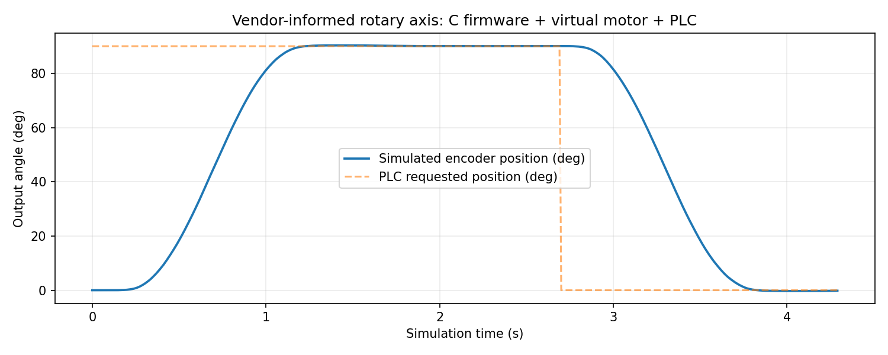
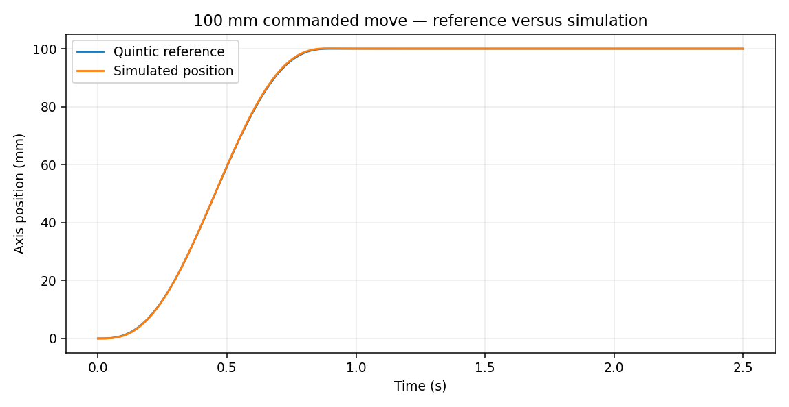

# Industrial Servo Motion Control — Digital Twin & C++ Control Runtime

> **Status:** tested engineering-software portfolio prototype. **No motor or drive hardware has been tested.** The electrical and mechanical model is explicitly assumed. This repository does not claim industrial real-time guarantees, certified safety, or a commissioned axis.

A reproducible software-in-the-loop (SIL) project combining **modern C++20**, **Python**, electromechanical modelling, cascaded motor control, smooth motion planning, encoder quantisation, command-state supervision, deterministic fault injection and quantitative verification.

It follows the **Intelligent CAD & CAE Automation** project: the original mechanical-axis assumptions (8 kg moving mass, 20 mm pulley radius, 0.85 efficiency and 0.35 m/s target speed) are preserved in `assets/cad_axis_reference.json`. The 3:1 gearing and all detailed motor/electrical data are *new illustrative assumptions*, not derived from an actual motor datasheet.

**Reference hardware selected (not yet built):** ST NUCLEO-G474RE + Pololu #4693 24 V brushed encoder gearmotor + Pololu #2992 PWM H-bridge for an isolated, current-limited benchtop prototype. See [`docs/SELECTED_BENCH_HARDWARE.md`](docs/SELECTED_BENCH_HARDWARE.md). **This reference hardware does not validate or match the hypothetical 8 kg linear-axis plant without redesign and measurement.**

## Software-only final virtual release — 28 October 2026

**Complete for the defined vendor-informed digital-twin scope. Not a hardware-tested servo drive.** The original hypothetical 8 kg linear-axis SIL is retained unchanged. A **separate rotary bench** now uses published specification values for the STM32G474RE, Pololu #4693 encoder gearmotor and #2992 H-bridge, with all unknown electrical/mechanical parameters marked **derived or assumed**.

The new bench executes the **same C firmware control core** both as a host shared library against a Python virtual motor and as freestanding Cortex-M4 compile-only code. It includes a virtual PLC command register contract, replay/acknowledgement protection, a simulated 90°→dwell→0° sequence, 12 fault classes, seeded assumption variations and a standalone offline engineering dashboard. It is not a physical HIL setup; the ARM ELF does not implement vendor ADC/PWM/encoder peripherals or qualify as flash-ready STM32 firmware.

- [Virtual engineering release and exact limitations](outputs/virtual_bench/VIRTUAL_ENGINEERING_RELEASE.md)
- [Offline interactive operator dashboard](outputs/virtual_bench/virtual_commissioning_dashboard.html)
- [Manufacturer data versus explicit assumptions](config/published_reference_bench.json)
- [Virtual interface and safety review](docs/VIRTUAL_INTERFACE_AND_WIRING_REVIEW.md)
- [Definition of software-only completion](docs/VIRTUAL_RELEASE_SCOPE.md)

```bash
python -m pip install -e '.[test]'
python tools/quality_gate.py   # original core tests + virtual release + generated evidence
```

A preinstalled ARM-capable LLVM/LLD toolchain additionally builds a Cortex-M4 ELF; on macOS without this cross-toolchain, host simulation still works and the ARM build omission is recorded. See `tools/build_virtual_firmware.py`.



## Implemented

- A rigid-belt electromechanical plant with RL winding, back-EMF, equivalent rotating inertia, viscous drag and smooth Coulomb friction; RK4 time stepping.
- Rest-to-rest fifth-order trajectories with analytic velocity, acceleration and jerk constraints.
- Cascaded **100 Hz position P / 250 Hz speed PI / 1 kHz current PI** control with voltage/current saturation and conditional anti-windup.
- A standalone C++20 controller compiled without ROS, PLC SDKs or vendor dependencies; generated configuration from the same Python-readable JSON.
- A virtual encoder, homing-state *supervisor prototype*, heartbeat/watchdog and latched simulated fault inputs.
- A Python virtual protocol with CRC32 and duplicate-command rejection, and a separate compact C++ fixed-size 12-byte test protocol with CRC16. **Neither is a real CANopen implementation.**
- Reproducible nominal, 6 N disturbance and six fault scenarios, plus a 100-sample synthetic parameter-variation study.
- A C++ SIL runner, full-rate Python traces, cross-language numerical comparison, static plots and a self-contained interactive HTML dashboard.
- A single verification script covering Python tests, C++ build/CTest, simulations and numerical consistency.

## Evidence at the pre-Codex checkpoint

See [`outputs/ENGINEERING_EVIDENCE.md`](outputs/ENGINEERING_EVIDENCE.md) and machine-readable [`outputs/evidence_summary.json`](outputs/evidence_summary.json).

| Result | Simulation evidence |
|---|---:|
| Intended travel | 100 mm |
| Nominal final position error | ~0.0011 mm |
| Nominal peak tracking error | ~0.312 mm |
| Nominal peak current | ~0.917 A |
| 6 N disturbance peak tracking error | ~0.457 mm |
| C++/Python max trajectory discrepancy | ~0.024 mm |
| 100-seed assumed parameter screen | 100/100 pass |
| Example simulated additional travel after mid-move drive disable | ~19 mm |

**These are numbers from an idealised offline plant, not achievable real-world performance guarantees.** The parameter screen uses invented independent uniform ranges and does not estimate physical-system reliability. The fault-stop comparison uses an assumed high-impedance drive disable with simplified friction; it is **not a certified emergency stop or validated coast distance**.

## View the evidence

Open [`outputs/servo_control_dashboard.html`](outputs/servo_control_dashboard.html) in a browser. It works offline and lets you inspect the simulated run frame by frame.



## Run locally

Requirements: Python 3.10+, `numpy`, `matplotlib`, `pytest`; CMake 3.16+ and a C++20 compiler for the native core.

```bash
python3 -m venv .venv
source .venv/bin/activate
python -m pip install -e '.[test]'
python tools/quality_gate.py
```

Run only the Python evidence builder:

```bash
PYTHONPATH=src python tools/build_evidence.py --samples 100 --seed 2026
PYTHONPATH=src python tools/generate_dashboard.py
```

Native C++:

```bash
python tools/generate_cpp_config.py
cmake -S cpp -B build/cpp -DCMAKE_BUILD_TYPE=Release
cmake --build build/cpp --parallel
ctest --test-dir build/cpp --output-on-failure
./build/cpp/servo_demo > outputs/cpp_sil_trace.csv
```

## Repository layout

| Folder | Purpose |
|---|---|
| `config/` | Explicit assumptions, engineering units and controller rates |
| `assets/` | Exact Mechanical CAD project axis reference |
| `src/servo_lab/` | Motor plant, planner, controllers, software supervisor and SIL campaign |
| `cpp/include/servo/` and `cpp/src/` | Portable no-dynamic-allocation control loop and virtual command protocol |
| `tests/` and `cpp/tests/` | Deterministic verification |
| `tools/` | C++ configuration generation, quality gate, evidence and dashboard |
| `outputs/` | Reported traces, figures, measurements and offline UI |
| `docs/` | Engineering assumptions, architecture, validation boundaries and handoff |


## Extended hardware-neutral pre-Work implementation (28 October 2026)

The software-only integration boundary has been extended **without vendor-specific firmware or physical hardware claims**:

- `cpp/include/servo/runtime.hpp` — portable C++ deterministic loop with default-off, timing-gap latch, NaN checks, real sensor/clock timestamps and fault reset/re-arm tests.
- `cpp/include/servo/hal.hpp` — callback-based I/O adapter and fake drive, with observed independent-interlock gating. This is **not** safety-rated motor protection.
- `cpp/include/servo/drive402.hpp` — simulated drive-state semantics inspired by CiA 402. **No actual CANopen/EtherCAT**.
- `src/servo_lab/plc_contract.py`, `modbus_tcp.py` — typed zero-based PLC registers and **localhost-only Modbus/TCP** test interface (function codes 03/04/06/16). No industrial-network or real-actuator security guarantees.
- `src/servo_lab/identification.py` — synthetic electrical RL and mechanical inertia/friction identification with holdout tests and excitation rejection; **not measured motor parameters**.
- `src/servo_lab/schedulability.py` — assumed-WCET fixed-priority response-time analysis; not an actual RTOS guarantee.
- `cpp/src/host_cycle_benchmark.cpp` — native function compute-time microbenchmark; not real-time jitter or true WCET.
- 64-case seeded software fault campaign, cross-language reference checks, expanded tests and updated engineering risk/porting specification.

**Expanded checks:** 71 Python tests, 4 native C++ test executables, 12 reproducibility stages, plus a separate AddressSanitizer and UndefinedBehaviorSanitizer pass on the C++ core.

Reproduce with the same single command:

```bash
PYTHONPATH=src python tools/quality_gate.py
```

Extended results: [`outputs/extended_prework/REPORT.md`](outputs/extended_prework/REPORT.md) and [`results.json`](outputs/extended_prework/results.json). The sole remaining work is **hardware/vendor-specific embedded, fieldbus and physical-validation integration**, not another simulated control-platform rewrite. See [`docs/NEXT_WORK_BOUNDARY.md`](docs/NEXT_WORK_BOUNDARY.md).

## What is not complete

1. Electrical motor identification from manufacturer data and measured torque/current/back-EMF/inductance.
2. Real motor driver and PWM/FOC implementation; switching behaviour is absent from the averaged DC-equivalent plant.
3. Actual microcontroller/RTOS target, ISR/ADC/encoder drivers and real-time jitter/deadline assessment.
4. CANopen/CiA 402 or EtherCAT integration; current protocol is deliberately simulated only.
5. Hardware homing, safety-related limit switches, independent emergency stop, safe torque off and risk assessment.
6. Closed-loop comparison against physical motor-axis measurements and thermal/fatigue validation.
7. PLC/HMI and commissioning of a real machine.

See [`docs/CURRENT_STATE.md`](docs/CURRENT_STATE.md) and [`WORK_HANDOFF.md`](WORK_HANDOFF.md) for bounded next steps. The technical scope is suitable for showcasing **control-software architecture and test methodology**, not for claiming a physically commissioned servo axis.
