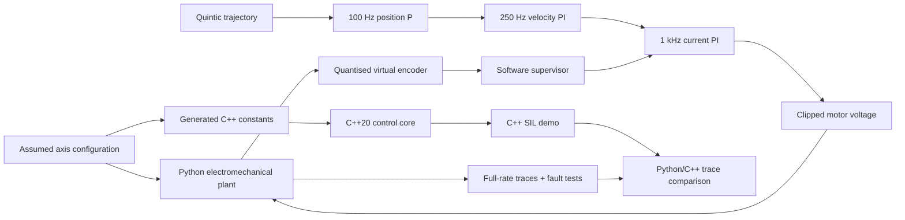

# Software architecture and verification boundary

## Design principles

- Use one JSON configuration as the editable assumed model. The C++ constants are generated; their source is not a manufacturer datasheet.
- Keep all motor/plant dynamics in the simulation package and the controller allocation-free in C++ `step`.
- No dependency on ROS, hardware vendor SDKs, FreeRTOS or Linux for the C++ core.
- Keep current/velocity/position loops at explicit integer multiples of 1 ms. This is a *simulated fixed rate*; no operating-system deadline measurement has been made.
- Supervision is a **software demonstration**, not safety-rated protection. Physical STO and independent limit interlocks must be designed separately.

## Software boundaries

Python `MotorPlant`: state θ, ω, i; back-emf; R/L, Kt, inertia reflection, nonlinear friction.

`QuinticMove`: smooth position/velocity/acceleration/jerk rest-to-rest reference.

`CascadedController`: position P, velocity PI, current PI with clamps and conditional anti-windup; equivalent C++ implementation.

`AxisSupervisor`: disabled/enabled/homing-seek/backoff/fault/estop modes, latched fault reasons, timeout checks. The sample software-in-loop runner bypasses physical homing and labels the bypass.

`VirtualEncoder`: position count quantisation, optional freeze/noise. The simulated speed input is ideal motor truth, and a real encoder-freeze diagnosis is **not established**.

`virtual_bus.hpp` / Python `protocol.py`: **two distinct, internal test protocols**. The fixed-size C++ frame format and Python JSON format are not wire-compatible; neither claims CANopen, EtherCAT or CiA 402 interoperability. Codex should select one versioned production interface before real integration.
