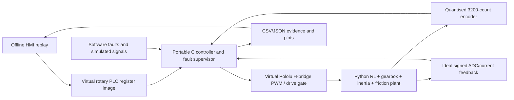

# Portfolio case study — Model-Based Servo Control without Hardware

**Industry-relevant problem:** Prototype and verify motor motion control, fault supervision and a PLC-facing command contract before physical hardware is available.

**Engineering deliverable:** A repeatable, manufacturer-informed **software-in-the-loop (SIL) / virtual commissioning** demonstrator—not a completed physical industrial servo or certified functional-safety system.

## Architecture (actual source modules)



**Portable C source:** `firmware/src/bench_core.c` (same control calculations compiled for host execution and ARM Cortex-M4 code generation). The original C++20/Python 8 kg linear-axis SIL is preserved as a *separate legacy demonstration*.

## Reproducibility

```bash
python -m pip install -e '.[test]'
python tools/quality_gate.py
```

The automated gate runs original C++ and Python tests, the virtual C firmware build, native sanitizers, synthetic vendor-informed motor/PLC scenarios, an uncertainty screen, dashboard generation and report acceptance checks. The backend used for the actual virtual execution is a C shared library called from Python; it is *not* a simulated full STM32 instruction-set emulator, and the ARM ELF is *not flash-ready board firmware*.

## Measured within the virtual model

Read `outputs/virtual_bench/VIRTUAL_ENGINEERING_RELEASE.md` for current values and acceptance results. The nominal software machine cycle moves the output from 0° to 90°, dwells, then returns to 0°. A selected set of fault signals is injected into the same control loop. The release evidence includes:

- `outputs/virtual_bench/rotary_motion.png` — virtual PLC target and simulated encoder position.
- `outputs/virtual_bench/current_and_pwm.png` — winding current and normalized software PWM.
- `outputs/virtual_bench/fault_coasting.png` — assumed open-circuit coasting; *not a safety distance*.
- `outputs/virtual_bench/virtual_commissioning_dashboard.html` — offline scenario replay with frame-by-frame telemetry.
- `outputs/virtual_bench/assumption_variation.csv` — fixed-seed sample of invented inertia/friction perturbations.
- `outputs/virtual_bench/release_results.json` — complete machine-readable status and metrics.

## Verified source data versus assumption

- Published Pololu #4693: 24 V, 50:1, 200 rpm output no-load, 0.10 A no-load, 3.0 A extrapolated stall, 3,200 output counts/rev quadrature x4.
- Published Pololu #2992: PWM/DIR/SLP driver; default 30 A current-chopping threshold far above the selected motor's 3 A extrapolated stall; current-sense output is invalid in some switching states.
- Published STM32G474RE: Cortex-M4 170 MHz, up to 512 KiB Flash and 128 KiB SRAM.
- Inferred from specs: ~8 Ω motor terminal resistance; ~0.02215 V/(rad/s) back-EMF constant.
- Assumed: 5 mH winding inductance, 70% gearbox efficiency, inertia, calibrated fictional friction split, a perfect signed current sensor, ideal interlock and deterministic 1 kHz loop.

Sources: [ST product](https://www.st.com/en/microcontrollers-microprocessors/stm32g474re.html) · [Pololu motor](https://www.pololu.com/product/4693) · [Pololu H-bridge](https://www.pololu.com/product/2992).

## Suitable CV wording

> Built a manufacturer-informed virtual commissioning environment for a brushed DC encoder motor using a freestanding C motion-control core cross-compiled for Cortex-M4, simulated motor/drive/PLC interfaces, fault injection and repeatable software verification. Documented manufacturer ratings, inferred motor constants, hypothetical loads and unvalidated hardware dependencies separately.

**Do not claim:** built a commercial motor drive, successfully flashed an STM32, implemented real CANopen, physically tested a safe stop, certified the wiring or commissioned a mechanical axis.
